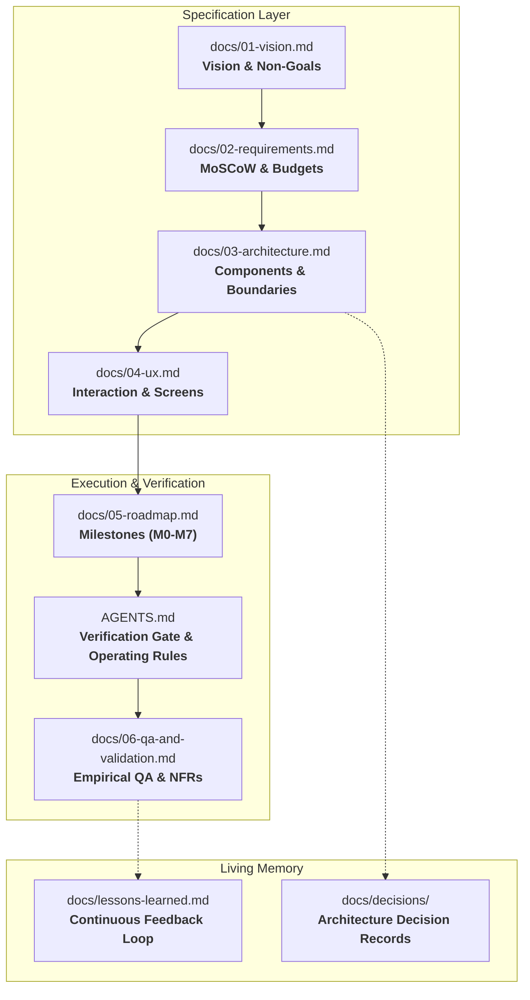

# 🚀 Project Template

[](docs/README.md)
[](AGENTS.md)
[](AGENTS.md#6-task-lifecycle)
[](LICENSE)

A battle-tested, **spec-first**, **agent-ready** project template engineered for high-velocity software development with autonomous AI coding agents and human engineers. Bootstrapped with the **Project Kickstart** methodology.

---

## 🌟 Why This Template?

Modern AI coding agents (Antigravity, GitHub Copilot, Claude Code, Cursor) are exceptionally fast at writing code, but they frequently encounter systemic failure modes in real-world repositories:
- **Context Drift:** Agents lose track of architecture decisions made 3 conversations ago.
- **Hallucinated Constraints:** Guessing unverified external APIs or hardware capabilities.
- **Chaos in Git History:** Uncontrolled parallel commits, broken main branches, and untracked rollbacks.
- **Siloed Knowledge:** Corrections and lessons learned in one chat session evaporate in the next.

This template eliminates these bottlenecks by embedding **operational constraints, architectural boundaries, and continuous learning directly into the repository files**.

---

## 🏛️ Core Architectural Pillars

### 1. The 7-Document Spec Stack (`docs/`)
All knowledge lives in version-controlled markdown specifications before any application code is written.



Detailed guides for each document are available in the [Documentation Guide](docs/README.md).

---

### 2. Multi-Agent Orchestration & Sole Committer Protocol
To prevent git merge collisions and untracked code commits during autonomous multi-agent execution:
- **Lead Agent (Sole Committer):** The only agent with permission to run `git commit`, `git push`, tag releases, or close GitHub issues.
- **Worker Subagents (`project-worker`):** Autonomous subagents that work in isolated git worktree branches on **disjoint files**. They run verification gates locally and return a structured completion report to the Lead Agent.
- **Parallel Work (`⇉`):** Roadmap tasks marked with `⇉` in [`docs/05-roadmap.md`](docs/05-roadmap.md) can execute simultaneously without file contention.

---

### 3. Complexity Tiers & Model Routing
Tasks are categorized by complexity to optimize both execution speed and cognitive capability:

| Tier | Scope | Recommended Model |
|---|---|---|
| **T1 Lean** | Pure deterministic logic, data schemas, unit tests, i18n, build scripts, docs | Fast / Lightweight models (e.g., Flash, Haiku) |
| **T2 Moderate** | UI layouts, standard IPC, platform integrations, standard REST/gRPC endpoints | Balanced models (e.g., Sonnet, Pro) |
| **T3 Critical** | Concurrency, safety-critical routines, crypto, custom hardware/kernel hooks, performance hot paths | High-reasoning models (e.g., Pro, Opus) |

*Any model downgrade due to quota or rate-limiting is logged in [`docs/model-fallback-log.md`](docs/model-fallback-log.md) for mandatory audit before release.*

---

### 4. Claims Follow Evidence
- **No Guesswork:** Never present unverified assumptions (hardware behaviors, external APIs, network latency) as fact.
- **Spikes (🔬):** Unverified technical points are isolated as Milestone 0 spikes and tested with real diagnostic probes.
- **Decoupled QA:** Headless automated mock/invariant tests run on every commit; manual or physical hardware testing stays marked **`Pending`** in [`docs/06-qa-and-validation.md`](docs/06-qa-and-validation.md) until empirically confirmed by the user.

---

### 5. The Continuous Learning Loop
Whenever an agent receives a correction or experiences a runtime friction point:
1. It does not simply apologize or quietly fix the code.
2. It documents the root cause and creates an actionable rule in [`docs/lessons-learned.md`](docs/lessons-learned.md).
3. Universal rules are promoted to [`AGENTS.md`](AGENTS.md) so every future agent session adheres to them immediately.

---

## 📂 Repository Tour

```text
├── .github/
│   ├── ISSUE_TEMPLATE/
│   │   ├── bug_report.yml          # Structured bug report with QA test IDs
│   │   └── feature_request.yml     # Feature requests tied to MoSCoW priorities
│   ├── copilot-instructions.md     # Instructions pointing GitHub Copilot to AGENTS.md
│   └── pull_request_template.md    # PR template enforcing verification gate checks
├── docs/
│   ├── decisions/
│   │   └── 0000-template.md        # Architecture Decision Record (ADR) skeleton
│   ├── 01-vision.md                # Vision, problem statement, principles, non-goals
│   ├── 02-requirements.md          # MoSCoW functional requirements & NFR budgets
│   ├── 03-architecture.md          # Component diagrams, tech stack, disjoint modules
│   ├── 04-ux.md                    # Interaction flows, screens, and accessibility
│   ├── 05-roadmap.md               # Sized milestone task board with parallel markers (⇉)
│   ├── 06-qa-and-validation.md     # Empirical validation matrix & budget measurements
│   ├── lessons-learned.md          # Living log of friction points and rules adopted
│   ├── model-fallback-log.md       # Audit trail for downgraded agent runs
│   ├── release-methodology.md      # SemVer, version source of truth, and release checklist
│   └── README.md                   # Comprehensive guide to the documentation system
├── AGENTS.md                       # Binding operational rules and verification gate
├── CHANGELOG.md                    # Chronological milestone changelog
├── CONTRIBUTING.md                 # Contribution and multi-agent pair programming guide
├── LICENSE                         # MIT License
└── README.md                       # Repository overview and onboarding
```

---

## 🚦 Getting Started

### Method A: Using as a GitHub Template (Recommended)
1. Click **"Use this template"** > **"Create a new repository"** on GitHub.
2. Clone your new repository locally:
   ```bash
   git clone https://github.com/<your-username>/<your-repo-name>.git
   cd <your-repo-name>
   ```
3. Open the repository in your favorite AI-enabled environment (Antigravity, Cursor, VS Code, etc.).
4. Run the Project Kickstart discovery flow:
   - In Antigravity: Run the `/project-kickstart` skill or prompt:
     > *"Initialize project definition using the templates in this repository."*
   - In other assistants: Prompt the agent to interview you following the sections in `docs/01-vision.md` through `05-roadmap.md`.
5. Review and approve the generated specifications.
6. Begin implementing Milestone 0 (Spikes) and Milestone 1 (Skeleton)!

### Method B: Manual Configuration
1. Fill in [`AGENTS.md`](AGENTS.md) with your project mission, critical complexity areas, verification gate commands, and hard rules.
2. Replace the `{{...}}` placeholders in `docs/01-vision.md` through `docs/05-roadmap.md`.
3. Set up your verification gate command in [`AGENTS.md`](AGENTS.md#6-task-lifecycle) (e.g., `cargo test`, `npm test`, `pytest`).
4. Commit your initial project specification.

---

## 🔄 The Milestone Lifecycle

Every project built with this template progresses through 8 structured milestones:

```text
M0: Spikes (🔬)           De-risk unknowns with disposable diagnostic probes.
M1: Skeleton              Establish module structure, CI pipeline, and verification gate.
M2: Core Logic            Implement deterministic domain logic (100% unit-tested).
M3: Integrations          Connect OS APIs, persistence, networking, and external services.
M4: User Interface        Build UI views, entry points, and state management.
M5: Hardening & QA        Measure NFR budgets, conduct edge-case and soak testing.
M6: Packaging & Release   Build binaries/artifacts, publish release notes and user documentation.
M7: Retrospective         Review lessons learned and promote generic rules to toolkits.
```

---

## 🛡️ Operating Rules for AI Agents

All AI assistants working on this repository must read and adhere to [`AGENTS.md`](AGENTS.md):
1. **Always read documents in mandatory order:** Vision -> Requirements -> Architecture -> UX -> Roadmap -> Findings -> ADRs -> Lessons Learned.
2. **Work on one roadmap task at a time:** Check off items in [`docs/05-roadmap.md`](docs/05-roadmap.md) with date and commit hash only after passing the verification gate.
3. **Run the Verification Gate:** Every change must satisfy the verification gate commands before being considered complete.
4. **Environment Resiliency:** Never assume standard toolchains are in `$PATH`; explicitly configure environment variables.
5. **Cross-Platform Hygiene:** Use UTF-8 encoding without BOM, avoid unconstrained recursive file searches over dependency caches (`node_modules`, `target`, `.venv`), and do not commit build artifacts.

---

## 📄 License

This template is licensed under the [MIT License](LICENSE). Feel free to use, adapt, and distribute it for personal and commercial projects.
