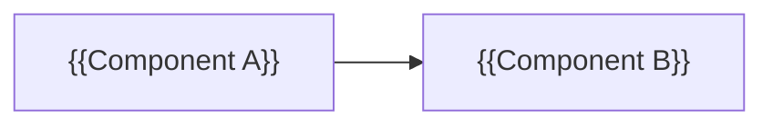

# 03 — Architecture

> Status: **DRAFT**. 🔬 = must be confirmed by a Milestone 0 spike.

## Tech stack (see `decisions/0001-*.md`)
| Concern | Choice |
|---|---|
| Language / runtime | {{}} |
| UI | {{}} |
| Config / storage | {{}} |
| i18n | {{}} |
| Build / CI | {{}} |

## Component / process model


## Module boundaries (designed for parallel work)
```
{{e.g.
crates|packages/
├── core/      # pure logic, no platform deps, 100% unit-tested
├── platform/  # OS / IO / device integration
├── ui/        # user interface
└── probe/     # M0 diagnostic tool}}
```
Rule: independent roadmap tasks should touch disjoint modules.

## Key technical designs
### {{Design 1, e.g. hot path}}
{{Mechanism, constraints, why}}

### {{Design 2}} 🔬
{{Unknowns and the planned fallback}}

## Rejected alternatives
- {{Option}}: rejected because {{reason}}.

## Known limitations
- {{e.g. OS restriction}}
