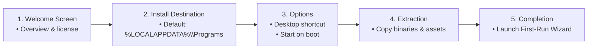
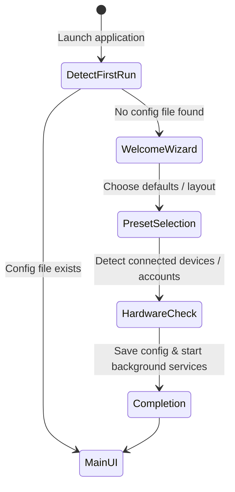

# 07 — UX Improvements & Product Evolution Backlog

> Status: **DRAFT / LIVING BACKLOG**  
> Purpose: Captures user experience polish, post-v1 ergonomics, guided onboarding flows, and backlog improvements identified during alpha/beta releases.

---

## 1. Guided Installation & Setup Wizard

### Objective:
Replace manual script or CLI execution with a seamless, user-friendly setup flow for non-technical users.

### Technical Requirements:
- **Zero UAC Elevation:** Default installation into user-level directories (`%LOCALAPPDATA%\Programs\<ProjectName>`).
- **Clean Uninstallation:** Complete removal of application files, shortcuts, and autostart registry entries.

---

## 2. First-Run Onboarding Flow

### Objective:
Guide the user through primary customization choices on initial launch so the application is immediately usable.

---

## 3. Responsive Layout & Accessibility Standards

- **Window Sizing & DPI Scaling:** Minimum dimensions, responsive reflow for small screens / high-DPI scaling (100% to 200%).
- **Keyboard Navigation & Tab Order:** Logical tab focus traversal for all interactive controls.
- **Color Contrast & Dark/Light Themes:** WCAG AA compliance (4.5:1 minimum contrast ratio).
- **Internationalization (i18n):** Zero hardcoded UI strings. All labels, buttons, tooltips, and dialogs defined in localization dictionaries (`locales/*.toml` or `locales/*.json`).

---

## 4. Product Enhancement Backlog

| Priority | ID | Feature / Improvement | Target Milestone | Notes |
|---|---|---|---|---|
| High | UX-01 | First-run onboarding wizard | M4 / M5 | Guided setup for new users |
| Medium | UX-02 | System tray / notification controls | M4 | Minimized background mode |
| Medium | UX-03 | Toast notifications on system events | M4 | Non-intrusive status alerts |
| Low | UX-04 | User theme selection (Dark / Light) | M5 | Theme persistence in config |
