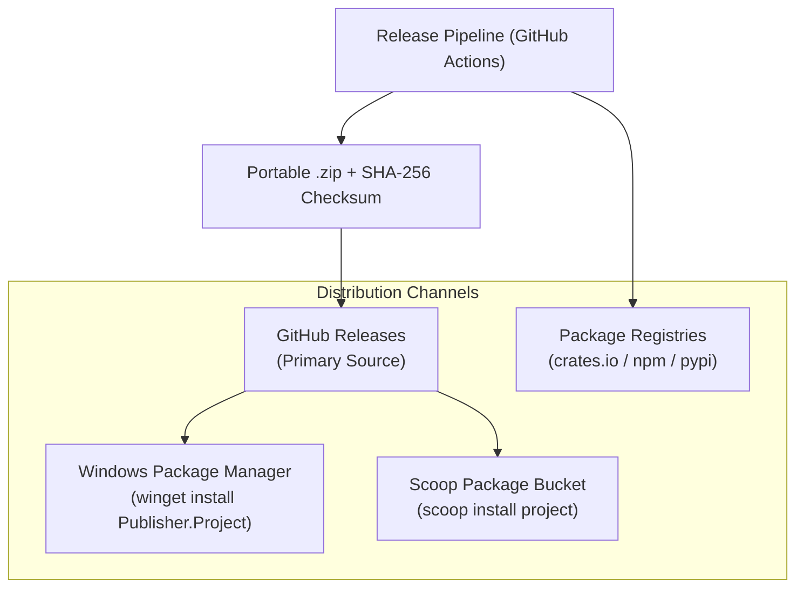

# 08 — Community Growth & Distribution Strategy

> Status: **DRAFT / STRATEGIC PLAN**  
> Purpose: Defines distribution channels, package manager automation, crowdsourced QA testing, and community adoption strategies.

---

## 1. Multi-Channel Distribution Architecture



---

## 2. Package Manager Automation

### A. Windows Package Manager (WinGet)
- **Manifest Location:** `packaging/winget/manifests/<version>/`
- **Automation:** Generated via `scripts/generate-manifests.ps1` with computed SHA-256 hash.
- **Submission:** `wingetcreate submit <release-url>` or automated GitHub Actions PR to `microsoft/winget-pkgs`.

### B. Scoop Package Bucket
- **Manifest Location:** `packaging/scoop/<ProjectName>.json`
- **Automation:** Self-updating manifest with `checkver` and `autoupdate` directives pointing to GitHub Releases.

---

## 3. Community Engagement & Crowdsourced Testing

### Crowdsourced QA Matrix:
- Encourage community members to test across varied OS editions, display scalings, and hardware peripherals.
- Use [`.github/ISSUE_TEMPLATE/qa_verification.yml`](../.github/ISSUE_TEMPLATE/qa_verification.yml) to collect structured empirical test reports.
- Verify report evidence before updating rows in [`docs/06-qa-and-validation.md`](06-qa-and-validation.md) from `Pending` to `PASS`.

---

## 4. Product Ecosystem Roadmap

```text
Phase 1: Frictionless Distribution
├── GitHub Releases with portable ZIP archives and SHA-256 checksums
├── Automated WinGet & Scoop package manifests
└── Clear README onboarding and demo GIF/assets

Phase 2: Public Launch & Feedback
├── Community launch on relevant developer forums (Reddit, Hacker News, Discord)
├── Issue templates for bug reports, feature requests, and agent tasks
└── Community localization contributions (translations)

Phase 3: Ecosystem Expansion
├── Extended platform support (macOS / Linux / Web)
├── Plugin or scripting extensions
└── Automated nightly / preview builds
```
