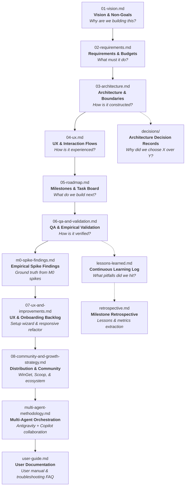

# Project Kickstart Documentation System

This directory contains the specification and governance documents that define the lifecycle of a software project built with the **Project Kickstart** methodology.

In an agent-assisted or autonomous engineering environment, **the codebase specifications are the primary interface between human intent and AI execution**. Keeping technical truth in version-controlled markdown files prevents context drift, hallucinated constraints, architectural fragmentation, and abandoned conventions.

---

## 📚 Specification Hierarchy & Reading Order

Whenever an agent or developer enters the workspace, documents must be consulted in this exact sequence before any code is generated or modified:

---

## 🗂️ Document Inventory

| File | Purpose | Key Content & Conventions |
|---|---|---|
| [`01-vision.md`](01-vision.md) | **North Star** | Problem statement, targeted user personas, core guiding principles in priority order, and explicit non-goals. |
| [`02-requirements.md`](02-requirements.md) | **Functional & Non-Functional Specs** | MoSCoW-prioritized features (`F1`, `F2`), quantitative non-functional budgets (`NFR-P1` latency, memory, CPU), and safety requirements. |
| [`03-architecture.md`](03-architecture.md) | **Structural Blueprint** | Tech stack selection, Mermaid component diagrams, directory boundaries designed for parallel agent execution, and key designs. |
| [`04-ux.md`](04-ux.md) | **Interaction Model** | UI screens, state diagrams (empty/loading/error/success), entry points (CLI/desktop/web), keyboard shortcuts, accessibility, and i18n rules. |
| [`05-roadmap.md`](05-roadmap.md) | **Single Source of Truth for Work** | Phased milestones (M0 through M7). Parallel tasks marked with `⇉`. Checked off with date and git commit ID upon verification. |
| [`06-qa-and-validation.md`](06-qa-and-validation.md) | **Empirical Proof & Test Matrices** | Empirical measurements of NFR budgets, real-environment hardware/manual QA matrices, edge case regressions, and incident reporting. |
| [`m0-spike-findings.md`](m0-spike-findings.md) | **Spike Ground Truth** | Empirical results and terminal outputs from Milestone 0 diagnostic spikes, de-risking APIs and hardware before core development. |
| [`07-ux-and-improvements.md`](07-ux-and-improvements.md) | **UX & Onboarding Backlog** | Specifications for guided installation wizards, first-run onboarding flows, responsive layout refactors, and post-v1 polish. |
| [`08-community-and-growth-strategy.md`](08-community-and-growth-strategy.md) | **Distribution & Community Strategy** | Multi-channel package distribution (WinGet, Scoop, registries), crowdsourced QA testing, and ecosystem expansion. |
| [`multi-agent-methodology.md`](multi-agent-methodology.md) | **Parallel & Cloud Agent Orchestration** | Hub-and-Spoke model, Sole Committer Protocol, complexity tiers, GitHub Copilot cloud agent integration, and Draft PR workflows. |
| [`user-guide.md`](user-guide.md) | **End-User Documentation** | Installation options, getting started guide, configuration reference, keyboard shortcuts, and troubleshooting FAQ. |
| [`decisions/`](decisions/) | **Architecture Decision Records (ADR)** | Lightweight records using [`0000-template.md`](decisions/0000-template.md) capturing context, choices considered, and rationale. |
| [`lessons-learned.md`](lessons-learned.md) | **Living Memory & Rules Engine** | Feedback log turning user corrections and debugging insights into enforceable engineering rules. Generic rules tagged `[KIT]` feed back into upstream tooling. |
| [`model-fallback-log.md`](model-fallback-log.md) | **Model Routing & Quota Audit** | Audit log tracking tasks run on fallback or lower-tier models, creating mandatory review items during M5 hardening. |
| [`release-methodology.md`](release-methodology.md) | **Release Engineering** | SemVer definitions, single source of version truth, automated release scripts (`scripts/package-release.ps1`), and GitHub Actions release automation. |
| [`retrospective.md`](retrospective.md) | **Milestone Retrospective** | Timeline, empirical failure analysis, multi-agent token economics, and lessons promoted to global guidelines. |

---

## 🔬 Core Working Agreements for Documentation

### 1. Claims Follow Evidence
Never write assertions into technical documents that have not been tested or measured.
- If an architectural assumption is unproven, mark it with **🔬 (spike)**.
- In [`06-qa-and-validation.md`](06-qa-and-validation.md), rows remain **`Pending`** until empirical evidence (date, test log, tester, hardware) is produced.
- Do not use marketing buzzwords ("pioneering", "blazing fast", "zero bugs") in technical specs.

### 2. Living Knowledge Loop
When a developer corrects a design or an agent makes a mistake:
1. Do not merely apologize or fix the code in isolation.
2. Record the root cause and the new preventative rule in [`lessons-learned.md`](lessons-learned.md).
3. If the rule is universally binding across all conversations, promote it to [`AGENTS.md`](../AGENTS.md) and [`.github/copilot-instructions.md`](../.github/copilot-instructions.md).

### 3. Disjoint Modules for Parallel Workers
[`03-architecture.md`](03-architecture.md) enforces that independent components live in separated directories (e.g., `core/`, `platform/`, `ui/`). This enables multi-agent swarms (`project-worker` subagents and GitHub Copilot Agent) to work concurrently in isolated git worktrees or branches without causing merge conflicts.

---

## 🛠️ Bootstrapping a New Project

When you initialize a project from this template:
1. Run the `/project-kickstart` skill with an Antigravity agent or answer the discovery interview questions.
2. The agent fills each template placeholder (`{{PROJECT_NAME}}`, `{{...}}`) with specific domain requirements.
3. Review and approve the generated draft specs in `docs/`.
4. Run Milestone 0 spikes to de-risk unknown APIs or hardware requirements and document findings in [`m0-spike-findings.md`](m0-spike-findings.md).
5. Transition the roadmap into active execution!
